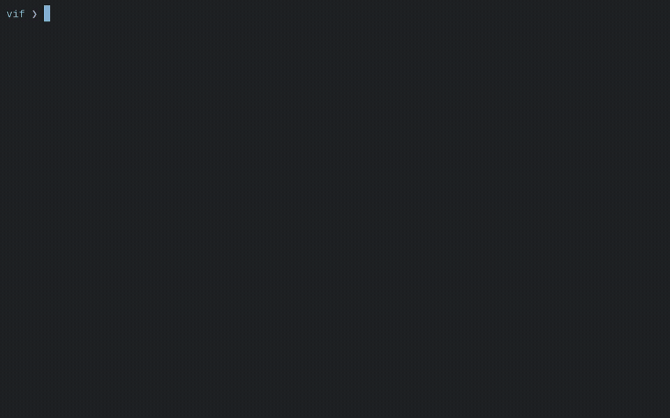
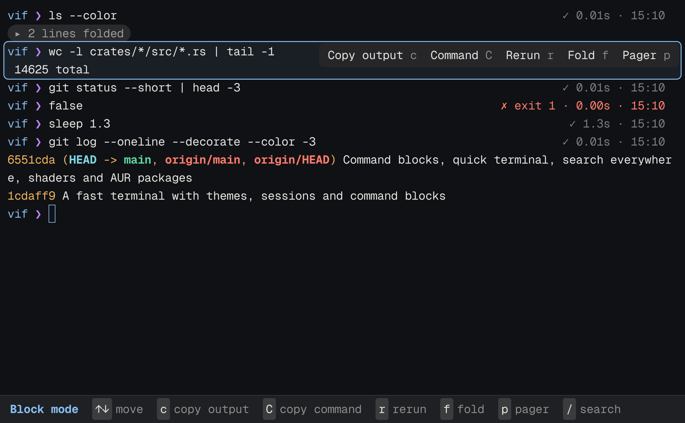
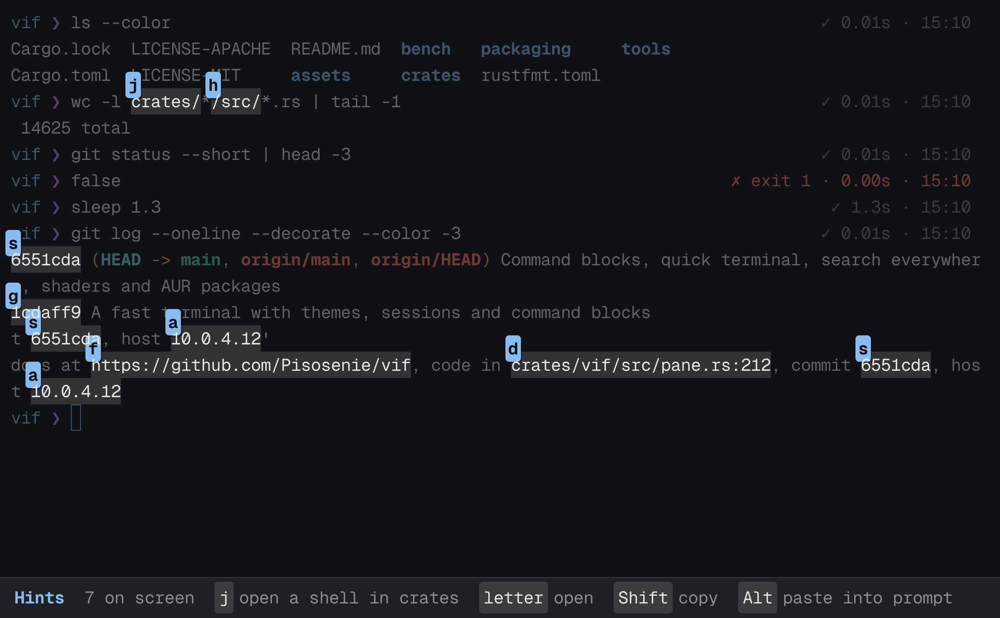
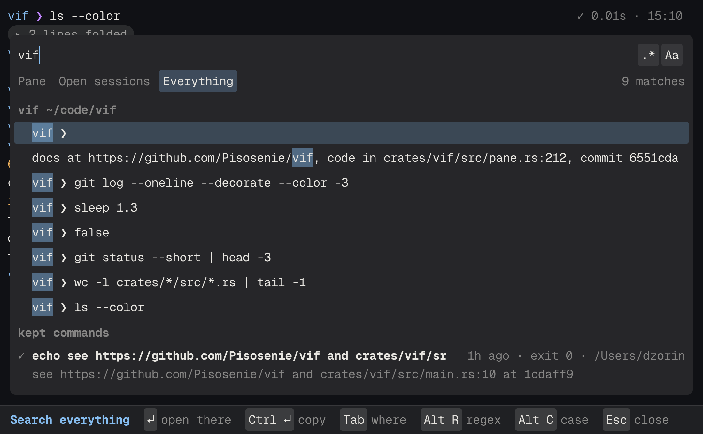
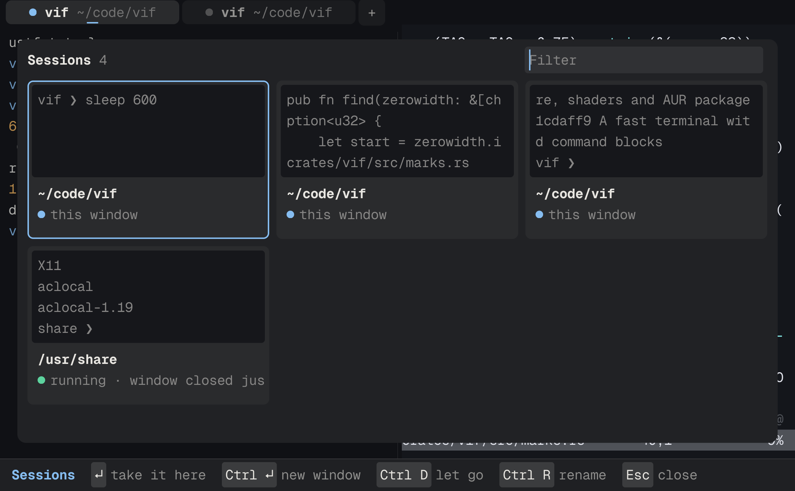
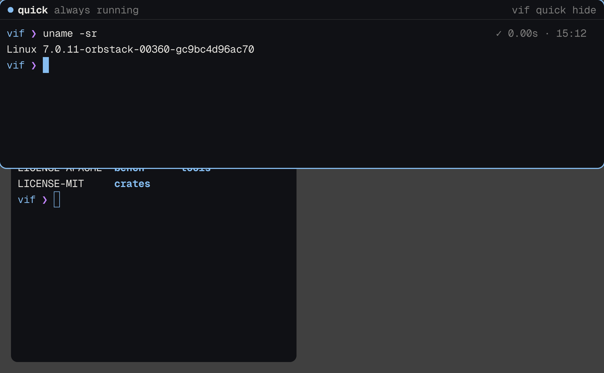
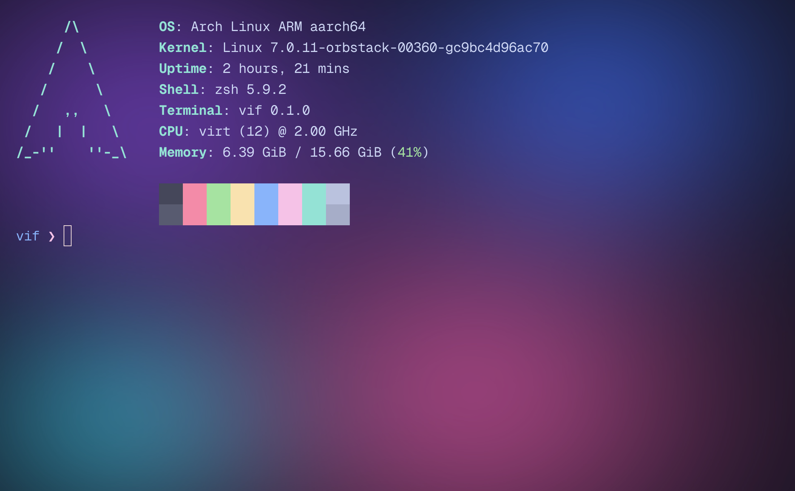
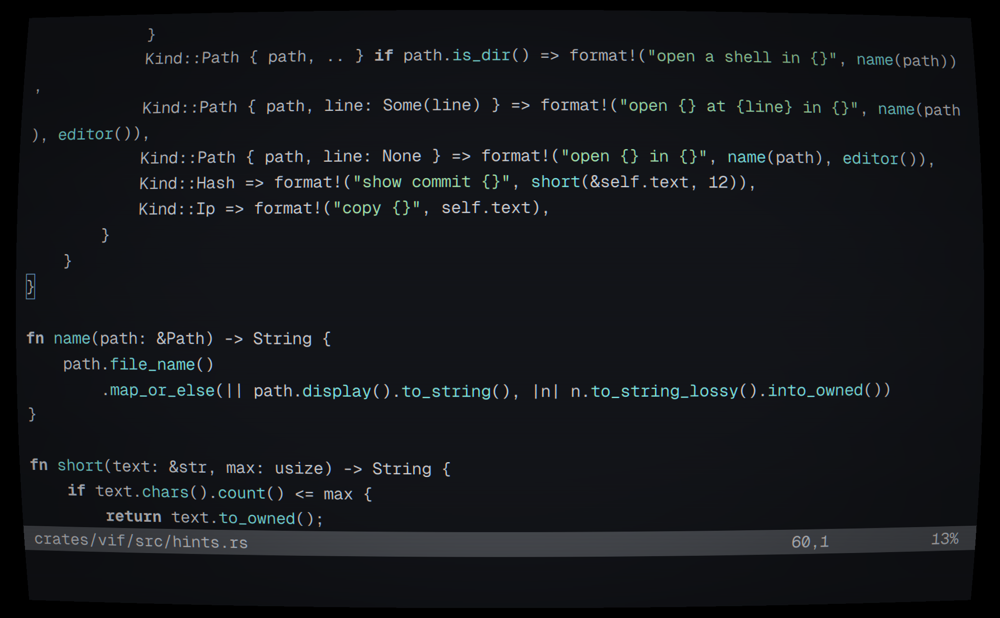
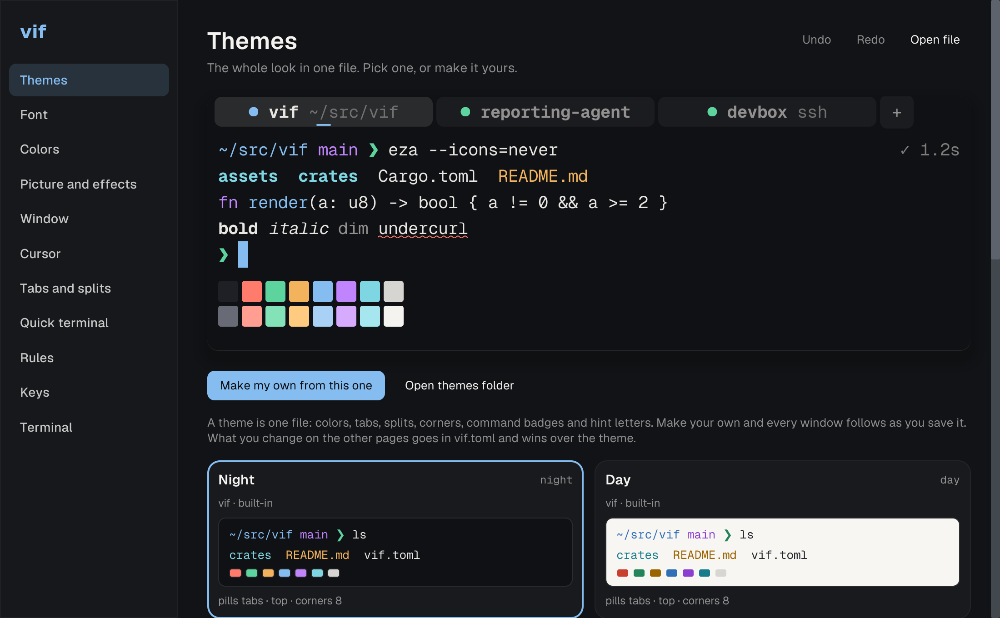

<h1 align="center">vif</h1>

<p align="center"><b>A fast GPU terminal emulator for Linux and macOS, written in Rust.</b><br>
Commands as blocks, shells that outlive their window, a drop-down quick terminal, Ghostty-compatible shaders and themes from any other terminal. Native on Wayland, packaged for Arch, at home under niri.</p>

<p align="center">
<a href="https://github.com/Pisosenie/vif/actions/workflows/ci.yml"></a>
<a href="https://github.com/Pisosenie/vif/releases"></a>


</p>



vif is a terminal for people who live in one. It draws on the GPU through wgpu (Metal on macOS, Vulkan or OpenGL on Linux), runs on Wayland without XWayland, and keeps the grid and parser that have run in Alacritty for years. What it adds is what a terminal is for all day: every command a block you can copy, fold and run again; shells that keep running when the window closes; a terminal that drops in from the top of the screen; a search through everything you ran. It is set up in a settings window with a live preview or in a plain `vif.toml`, and both change every open window as you go.

It is quick to start, light on memory and as fast as Alacritty on throughput; see [Speed](#speed). Keys here are written the macOS way; on Linux ⌘ is ctrl+shift, and [the table](#setting-it-up) has both.

## Commands as blocks



zsh and bash mark their prompts and commands without you touching their rc files (fish 4 does it on its own, and Powerlevel10k works too). Every command gets a badge with its exit code, how long it took and when it ended. ⌘↑ picks one as a block: copy what it printed, copy the command, run it again, fold its output into one line, open it in a pager, or ask for a notification when a long one ends. Like Warp's blocks, with no account and nothing leaving the machine.

## Ask a model, on your machine

Off until you turn it on, and then local by default: vif asks [Ollama](https://ollama.com) on this machine, or any OpenAI-compatible API you point it at. In block mode `e` asks why a failed command failed, from the command, its exit code, its folder and the end of what it printed; the answer streams in under it, and Enter types the fix it suggests at the prompt. ⌘I turns the words at the prompt (`find files over 100 MB from this week`) into a command in their place. Nothing runs by itself, nothing is sent until you ask, tokens, keys and passwords are taken out of what is, and there's no account. It goes through `curl`, so vif carries no HTTP of its own, and an API key is read from an environment variable you name, never from `vif.toml`.

## Hints



⇧⌘H gives every link, path with a line number, commit hash and IP address on screen a letter. The letter opens it where it belongs: a link in the browser, `pane.rs:212` in your `$EDITOR` at that line, a commit as `git show`, a folder as a shell there. Shift copies it, Alt pastes it at the prompt. ⌘-click (ctrl-click on Linux) does the same for any path.

## Search everything



⇧⌘F searches what this pane shows, what every open pane shows, or all of that and every command kept on this machine with what it printed, for 30 days by default. Words or a regular expression (⌥R), with case or without (⌥C); Enter goes to the line where it is, `vif history WORDS` searches from the shell.

What is kept stays on this machine in files only you can read (0600, in a 0700 folder). Tokens, keys and passwords are taken out before anything is written: `NAME=value` where the name says it's a secret, GitHub, GitLab, OpenAI, Slack, AWS and Google tokens, bearer headers, JWTs and private keys. A command typed with a space in front isn't kept at all, and `archive_days = 0` keeps nothing.

## Shells that outlive their window



Each shell runs under a small host process, so closing the window or quitting vif leaves it running, and the next vif brings it back in the same windows, tabs and splits with its scrollback and variables, like tmux without tmux. A host starts in about 11 ms and output through it is no slower; closing a tab or typing `exit` ends one for good. Even a restart doesn't lose the windows: they come back with their tabs and splits, a new shell in each pane's folder, and what the old one printed last above it. ⇧⌘S shows every session as a card with what is on its screen: Enter takes one here, ctrl-Enter into a window of its own, ctrl-D lets it go and leaves it running, ctrl-R names it, and `vif attach build` opens it from anywhere. `sessions = false` turns it all off.

On another machine too: `vif ssh prod` opens a shell on `prod` that lives in a session there, so a dropped connection, a laptop lid or a train tunnel loses nothing. vif connects again by itself and the screen comes back as it was; `vif ssh prod build` names the session, and the same command later takes it back from anywhere. The shell over there gets vif's shell integration, so commands are blocks there as here. It needs vif installed on that machine as well, and nothing else: no daemon, no open port, only ssh.

## A quick terminal



One terminal that drops in from the top of the screen and goes away again, its shell always running, like Guake, Yakuake or iTerm2's hotkey window. On macOS a key you choose calls it from any app and gives the focus back after; under niri and sway `vif quick` is bound by the compositor, and `vif niri` writes the window rule and the key for you.

## Made for ricing



- **Themes that change the whole look**, not only colors: where the tabs sit and how they are drawn, how splits part and fade, the corners, the badges. Nine come built in, a theme of your own is one file, and windows follow it as you save.
- **Any terminal's colors**: `vif theme add` reads kitty, Ghostty, Alacritty, WezTerm, foot, iTerm2, Konsole, Windows Terminal, VS Code, base16 and Xresources files, from a path or a URL.
- **pywal**: `[colors] from = "wal"` follows your wallpaper's colors as they change.
- **A picture behind the text**, faded and blurred once when it loads, so it costs nothing after.
- **Shaders over the whole window** in Shadertoy's GLSL, the format Ghostty uses, so its shader collections work as they are. `crt`, `bloom` and a cursor trail come with vif; they draw only while something moves.
- **Fonts**: a weight for regular and bold, a cursive italic from another face, OpenType features like `ss01`.
- **GIFs in text**: `vif gif cat.gif` plays a GIF as colored ASCII where you are, `--blocks` draws it in ▀ halves at twice the detail, `--text` turns it into plain text frames. It scales every frame once before it starts and then only writes the lines that change, so it plays at under 1% CPU in 8 MB, in any terminal.
- **A greeting, like neofetch**: `[greeting] show = "window"` plays a GIF (or shows a PNG or JPEG) above the first prompt of each window, with who you are, the system, the shell, the CPU, the memory and the 16 colors beside it. The picture stays and the prompt comes up under it; it waits for your rc files, plays once (or `loops` times), and ctrl-c cuts it short. In Settings pick the file with Choose…, or run `vif greet` in any terminal.



## Set up in a window or a file



⌘, opens the settings window (vif → Settings… on macOS, `vif settings` from a shell). Its preview is drawn by the terminal's own renderer, and next to it are the exact lines of `vif.toml` it writes, with your comments and order kept. Or edit the file: a typo never stops anything, the window says which line is wrong and what you probably meant, and `vif set window.opacity 0.9` changes one setting from the shell.

## Installing

**Arch Linux.** Three packages, each with its `.SRCINFO`: `packaging/arch/vif-bin` takes the release's prebuilt binaries and installs in seconds, `vif` builds the release, and `vif-git` the newest commit:

```sh
git clone https://github.com/Pisosenie/vif
cd vif/packaging/arch/vif-bin && makepkg -si
```

All three install `vif`, `vif-settings`, the `xterm-vif` terminfo for every program, a desktop entry and the icon. vif links only glibc and libgcc; Wayland, xkbcommon, Vulkan and EGL are opened when it runs.

**macOS 13 or later**, Apple silicon or Intel, with Homebrew:

```sh
brew install --cask pisosenie/tap/vif
```

or download `vif-<version>-macos.zip` from [Releases](https://github.com/Pisosenie/vif/releases), unzip it and drag `vif.app` to Applications. The app isn't notarized yet, so macOS refuses it the first time: open it once with System Settings → Privacy & Security → Open Anyway, or run

```sh
xattr -dr com.apple.quarantine /Applications/vif.app
```

**Debian 12, Ubuntu 22.04 and newer**, amd64 or arm64: `vif_<version>_<arch>.deb` from [Releases](https://github.com/Pisosenie/vif/releases), installed with what it needs:

```sh
sudo apt install ./vif_0.1.5_amd64.deb
```

**Other Linux**, x86_64 or aarch64: `vif-<version>-<arch>-linux.tar.gz` from [Releases](https://github.com/Pisosenie/vif/releases), built on Ubuntu 22.04, so it runs with glibc 2.35 or newer. Unpack it and run `./install.sh`, which puts `vif` and `vif-settings` in `~/.local/bin` with a desktop entry and the icon (`sudo ./install.sh /usr/local` for everyone). It needs Wayland or X11, and Vulkan or OpenGL.

**From source**, with a current stable Rust:

```sh
cargo build --release
target/release/vif
```

`vif-settings` has to sit next to `vif` (or on `PATH`) for ⌘, to find it. `tools/bundle-macos.sh` builds `vif.app` (`--universal` for both kinds of Mac), `tools/package-linux.sh` the Linux tarball, and `tools/headless.sh shot.png` screenshots vif under a throwaway headless sway.

## Under Apolline and niri

vif takes [Apolline](https://github.com/Pisosenie/apolline)'s accent for its cursor, selection, tabs and badges as Apolline changes it, and leaves its window to Apolline's rules: the rounded corners, the opacity of windows in front and behind. With no title bar of its own on Linux, a vif window is niri's to frame.

For the quick terminal, `vif niri` writes the niri side from your `vif.toml`: a rule that floats `vif-quick` along the top at `[quick] height`, and `Mod+`` to show and hide it. Keep it next to the fragment Apolline includes:

```sh
vif niri > ~/.config/niri/vif.kdl
echo 'include "vif.kdl"' >> ~/.config/niri/config.kdl
```

Run `vif niri` again after changing the height. To open vif where niri opens a terminal, point your `Mod+T` at it: `Mod+T { spawn "vif"; }`. vif's own shortcuts use ctrl+shift on Linux, so none of them meet niri's or Apolline's `Mod` keys. Under sway the same takes `for_window [app_id="vif-quick"] floating enable, resize set 100 ppt 45 ppt, move position 0 0` and `bindsym $mod+grave exec vif quick`.

## Everything else

- GPU rendering through wgpu: Metal on macOS, Vulkan on Linux. Glyph atlases that grow as needed, instanced quads, a frame only when something changed, and only the changed rows rebuilt.
- Text through swash: ligatures, variable fonts, color emoji, fallback to the system's fonts per Unicode block. Box drawing, block elements, braille and powerline symbols are drawn to fit the cell, so lines join with no gaps. Geist Mono is built in.
- True color, every underline style with its own color (undercurl included), OSC 8 links, OSC 52 clipboard, synchronized output (mode 2026), bracketed paste, focus events, mouse reporting, the kitty keyboard protocol, and kitty graphics: PNG and raw pixels, inline, chunked, from a file, zlib or not. An image takes up cells like text, so it scrolls and clears with them.
- Shortcuts work in any keyboard layout: ⌘C and ctrl+w mean the Latin key even with Russian on.
- Tabs in the title bar and splits in any direction, each opening in the folder of the pane you are in. Drag a divider or move it with keys; zoom one pane to the whole tab and back, like tmux's `prefix z`. Each tab says its folder or host and, quieter after it, what runs there.
- In block mode `c` copies the output, `C` the command, `r` runs it again, `f` folds it, `p` opens it in a pager, `n` notifies when a running one ends, `/` searches. A command that runs longer than `notify_after` and ends while you look elsewhere sends a notification; on Linux it has Show block, which brings the command up picked.
- A program that paints its own background, like vim or htop, paints it to the window's edges.
- On Linux the clipboard goes through the window's own Wayland connection, with the primary selection.
- Under [Apolline](https://github.com/Pisosenie/apolline) the cursor, selection and accent follow its accent color as it changes.
- A scrollbar while you look back, marked where each prompt is, red where a command failed and in the accent where a search matched.
- Rules by host and folder: a pane `ssh`'d into a matching host, or sitting in a matching folder, takes the rule's theme and a label, so production never looks like your laptop. The host needs nothing installed.
- A command palette, ⇧⌘P: every action with its keys, every theme and every settings page.
- `vif set window.opacity 0.9` changes one setting from the shell, keeps your comments, and says when a key is misspelled.
- Checked inside it: tmux with splits, vim, Neovim (its spell check draws as undercurl), htop and Midnight Commander, with their colors and box lines whole.
- Its own terminfo, `xterm-vif`, so vim gets undercurl and cursor shapes; hosts over `ssh` that don't know it get `xterm-256color` without you doing anything.

## What is stable

Stable, and used every day: the terminal itself, tabs and splits, blocks, hints, search, the archive, sessions, themes, rules, the config and the settings window.

Newer, and may still change: asking a model, `vif ssh`, shaders, the picture behind the text, kitty graphics, the quick terminal's hotkey on macOS, `vif gif` and the greeting. Reports are welcome.

## Speed

MacBook Pro M2 Pro, macOS 26.5.1, 120 Hz display. vif 0.1.0, Alacritty 0.17.0, kitty 0.49.2, Ghostty 1.3.1. Every terminal ran with its defaults plus font size 13 and a 100×30 window. Lower is better; the best result is in bold.

| | vif | Alacritty | kitty | Ghostty |
|---|---:|---:|---:|---:|
| Window on screen after launch, median of 10 | **226 ms** | 303 ms | 500 ms | 387 ms |
| Key press to pixels, median of 30 | **22.6 ms** | 24.6 ms | 28.1 ms | 32.7 ms |
| Key press to pixels, 90th percentile | **32.6 ms** | 38.5 ms | 39.8 ms | 46.6 ms |
| Memory with one idle window | **93 MB** | 98 MB | 124 MB + 58 MB helpers | 115 MB |

Throughput, [vtebench](https://github.com/alacritty/vtebench) `ead8003`, median milliseconds per sample:

| vtebench | vif | Alacritty | kitty | Ghostty |
|---|---:|---:|---:|---:|
| dense_cells | **8** | **8** | 11 | 12 |
| medium_cells | **10** | **10** | **10** | 18 |
| scrolling | **23** | 32 | 91 | 28 |
| scrolling_bottom_region | **13** | **13** | 41 | 28 |
| scrolling_bottom_small_region | **13** | **13** | 43 | 28 |
| scrolling_fullscreen | **36** | 37 | 221 | 37 |
| scrolling_top_region | 35 | 36 | 42 | **29** |
| scrolling_top_small_region | **13** | **13** | 43 | 28 |
| sync_medium_cells | **13** | **13** | 19 | 20 |
| unicode | 11 | **8** | 15 | 10 |

What each number is:

- **Window on screen**: from starting the process to its new window showing up in the window list. vif shows its window only once the first frame is drawn, so its number includes drawing; the others may show an empty window first.
- **Key press to pixels**: a key is posted with CGEvent into `cat` running in the terminal, and ScreenCaptureKit watches the first text line until it changes. This is the whole path through macOS and the compositor, like [Typometer](https://github.com/pavelfatin/typometer), so it is the same for everyone and only the differences matter.
- **Memory**: resident size of the terminal process with one window and a shell, four seconds after launch.

Run them yourself with `bench/run.sh` (or `bench/run.sh latency` for one); it starts and closes only its own processes.

On Linux: Arch on an arm64 virtual machine (12 cores), under headless sway with no GPU, so every GPU terminal draws through Mesa's software renderer. vif 0.1.3, Alacritty 0.17.0, kitty 0.49.2, foot 1.28.0 (Ghostty has no arm64 Arch package), all with their defaults.

| | vif | Alacritty | kitty | foot |
|---|---:|---:|---:|---:|
| Window on screen, median of 10 | 123 ms | 126 ms | 124 ms | **37 ms** |
| Memory when idle | 273 MB | 204 MB | 368 MB | **44 MB** |
| vtebench dense_cells | **39 ms** | 87 ms | 135 ms | 88 ms |
| vtebench cursor_motion | **10 ms** | **10 ms** | 76 ms | 28 ms |
| vtebench scrolling_bottom_small_region | **94 ms** | 106 ms | 125 ms | 118 ms |
| vtebench scrolling_top_small_region | **92 ms** | 104 ms | 110 ms | 117.5 ms |
| vtebench scrolling_bottom_region | **104 ms** | 117 ms | 126 ms | 126 ms |
| vtebench unicode | **7 ms** | 9 ms | 8 ms | 13 ms |
| vtebench scrolling | 126 ms | **106 ms** | 200 ms | 136 ms |
| vtebench scrolling_top_region | 105 ms | **101 ms** | 126 ms | 107 ms |
| vtebench sync_medium_cells | 12 ms | 9 ms | 55 ms | **8 ms** |
| vtebench medium_cells | 9 ms | 8 ms | 31 ms | **6 ms** |
| vtebench light_cells | 11 ms | 18 ms | 9 ms | **4 ms** |
| vtebench scrolling_fullscreen | 13.5 ms | 17 ms | 27 ms | **7 ms** |

foot draws on the CPU, so with no GPU it starts fastest and is lightest; the GPU terminals' memory here is mostly the software renderer's, which is why the Mac numbers above are the ones to compare on memory. vif is the fastest of the four on six of the twelve throughput tests. `bench/linux.sh` runs it under its own headless sway; a key-to-pixel number needs a real display, so it isn't measured here.

## Themes

A theme is one TOML file with the whole look. `vif.toml` picks one with `theme = "name"` at the top, and anything `vif.toml` sets itself still wins over the theme, the way oh-my-zsh lets your own lines win over its theme.

```sh
vif theme                  # list them, * marks the one in use
vif theme use gruvbox      # every open window switches
vif theme new mine         # ~/.config/vif/themes/mine.toml, every key filled in from the current theme
vif theme add https://example.com/neon.toml   # or a file
vif theme check mine       # problems in it, with line and fix
```

Built in: `night` (the default), `day`, `dracula`, `catppuccin` (Mocha), `gruvbox`, `nord`, `phosphor`, `paper` and `alarm`, the red one for [rules](#rules) on production hosts. They differ in more than colors: gruvbox has powerline tabs and square corners, catppuccin keeps its tabs at the bottom with the folder for a title, phosphor is green on black with plain `[1] title` tabs and `ok`/`err` badges.

A theme of your own lives in `~/.config/vif/themes/<name>.toml` and can start from another one and change only what differs:

```toml
name = "Neon"
author = "you"
extends = "night"

[colors]
background = "#0b0b12"
accent = "#ff4fd8"

[window]
radius = 14                # corners of tabs, panels and hint labels; 0 for square

[tabs]
position = "bottom"        # "top"
style = "powerline"        # "pills", "underline", "plain"
show = "always"            # "many" hides the bar with one tab, "never"
title = "{index} {dir}"    # {index}, {title}, {cwd}, {dir}

[panes]
divider = "gap"            # "line"
dim = 0.4                  # how far splits without focus fade, 0 to 0.9

[badges]
show = "all"               # "failures", "none"
ok = "✓"
failed = "✗"
running = "●"
clock = true               # the time of day a command ended

[hints]
alphabet = "asdfjkl"
```

A theme sets the look: `[colors]`, `[font]`, `[window]`, `[cursor]`, `[tabs]`, `[panes]`, `[badges]` and `[hints]`. Shell and keys stay in `vif.toml`. The settings window opens on its Themes page: every theme as a card in its own colors, one click to switch, one to make it yours.

## Rules

```toml
[[rules]]
host = "prod-*"          # what ssh connects to, * and ? as wildcards
theme = "alarm"          # the built-in red one, or any theme
label = "PROD"

[[rules]]
dir = "~/work/infra*"    # this folder and everything inside it
accent = "#f2b35c"
label = "INFRA"
```

The first rule that fits a pane wins; `theme`, `accent`, `background` and `label` are each optional.

## Setting it up

⌘, (ctrl+, on Linux) opens the settings window. It shows a preview drawn by the same renderer as the terminal, and next to it the exact lines of `vif.toml` it wrote, with the changed one marked. Comments and the order of your file stay; ⌘Z undoes. Colors include all 16 palette slots; a shortcut can be typed or recorded by pressing it. `vif-settings --page keys` opens on a page.

Or edit `~/.config/vif/vif.toml` (or `$VIF_CONFIG`) by hand. A typo doesn't stop anything: the window shows which line is wrong and what you probably meant, and everything else applies. `vif check` prints the same:

```
   7 │ opactiy = 0.9
     │ ^^^^^^^ unknown window setting “opactiy”, did you mean “opacity”?
```

Everything there is, with the defaults:

```toml
theme = "night"            # see Themes; the sections below override it

[font]
family = "Geist Mono"
size = 13
line_height = 1.2
ligatures = true
weight = 400
bold_weight = 700
# italic_family = "Victor Mono"   bold_family too
# features = ["ss01", "-calt"]

[colors]
# foreground, background, cursor, selection, accent = "#rrggbb"
# palette = ["#1e2026", …]  up to 16 colors
apolline = true            # take Apolline's accent for cursor, selection and accent while it runs
# from = "wal"             # follow pywal, or a color file from kitty, Ghostty, Alacritty, iTerm…

[window]
padding = [12, 10]         # or one number
opacity = 1.0
blur = 0                   # anything above 0 blurs what's behind a see-through window
columns = 100
lines = 30
decorations = "transparent"  # macOS: tabs in the title bar; Linux: no title bar, the compositor draws borders. "full" or "none"
radius = 8                 # corners of tabs, panels and hint labels
# shader = ["crt"]         # built-in names, or files in shaders/ next to vif.toml

[background]
# image = "~/Pictures/wall.jpg"
fit = "cover"              # "contain", "stretch", "center", "tile"
dim = 0                    # 0 to 1, toward the background color
blur = 0                   # pixels

[cursor]
shape = "block"            # "beam", "underline"
blink = false
trail = false              # a streak where the cursor jumps from

[terminal]
# shell = "/bin/zsh"
# args = ["-l"]
scrollback = 10000
term = "xterm-vif"
osc52 = "copy"             # "off", "paste", "both"
kitty_keyboard = true
option_as_alt = "none"     # macOS: "left", "right", "both"
shell_integration = true   # zsh and bash mark prompts and commands (OSC 133)
notify_after = 10          # seconds; a longer command that ends out of sight notifies, 0 never
sessions = true            # shells live on when their window closes
archive_days = 30          # keep each command and its output this long, 0 keeps nothing

[tabs]
position = "top"
style = "pills"
show = "many"
title = "{dir}"            # also {index}, {title}, {cwd}; {dir} is the host over ssh
detail = true              # what runs there, or the folder, after the title
plus = true

[panes]
divider = "line"
dim = 0.28

[badges]
show = "all"
ok = "✓"
failed = "✗"
running = "●"

[hints]
alphabet = "asdfghjklqwertyuiopzxcvbnm"

[ai]
enabled = false            # nothing is asked or sent until this is true
url = "http://localhost:11434/v1"   # Ollama; any OpenAI-compatible API works
model = "qwen2.5-coder:7b"
key_env = ""               # the environment variable with an API key, like "OPENAI_API_KEY"
send = 8000                # the most characters of a command's output one question sends

[greeting]
show = "off"               # "window" plays it in each new window's first shell, "always" in every new shell
file = ""                  # a GIF, PNG or JPEG, like "~/Pictures/cat.gif"
blocks = true              # ▀ halves in color; false draws characters
info = true                # who, the system, the shell, the colors beside it
height = 12                # lines the picture may take
loops = 1                  # times a GIF plays before the prompt

[quick]
key = ""                   # macOS, like "ctrl+alt+space"; elsewhere bind `vif quick`
height = 0.45
hide_on_blur = true

[keys]
"cmd+shift+t" = "new_tab"  # an action, or "none" to free a default
```

Default keys:

| | macOS | Linux |
|---|---|---|
| New tab, window, close | ⌘T, ⌘N, ⌘W | ctrl+shift+t, ctrl+shift+n, ctrl+shift+w |
| Split right, split down | ⌘D, ⇧⌘D | ctrl+shift+d, ctrl+shift+e |
| Next and previous pane | ⌘], ⌘[ | ctrl+shift+], ctrl+shift+[ |
| Pane by direction | ⌥⌘ arrows | ctrl+alt arrows |
| Move the divider (or drag it) | ⌃⌘ arrows | ctrl+shift+alt arrows |
| Zoom a pane to the whole tab | ⇧⌘Enter | ctrl+shift+z |
| Switch tabs | ⇧⌘], ⇧⌘[, ⌘1…⌘9 | ctrl+tab, ctrl+shift+tab, alt+1…alt+9 |
| Copy, paste, find | ⌘C, ⌘V, ⌘F | ctrl+shift+c, ctrl+shift+v, ctrl+shift+f |
| Pick a command block | ⌘↑, ⌘↓ | ctrl+shift+up, ctrl+shift+down |
| Copy the last output | ⇧⌘C | ctrl+alt+c |
| Hints | ⇧⌘H | ctrl+shift+h |
| Search everything | ⇧⌘F | ctrl+alt+f |
| Sessions | ⇧⌘S | ctrl+shift+s |
| Command palette | ⇧⌘P | ctrl+shift+p |
| Font size | ⌘=, ⌘-, ⌘0 | ctrl+=, ctrl+-, ctrl+0 |
| Scroll | ⇧PageUp, ⇧PageDown, ⌘Home, ⌘End | shift+pageup, shift+pagedown, ctrl+shift+home, ctrl+shift+end |
| Settings | ⌘, | ctrl+, |
| Words at the prompt to a command (AI) | ⌘I | ctrl+shift+i |
| Quick terminal | `[quick] key` | bound by the compositor, see `vif niri` |

## Inside

- `crates/config`: `vif.toml` read with every problem reported and nothing fatal, and written in place with `toml_edit`. Themes are read the same way and laid under it; the built-in ones are in `assets/themes`. Colors from other terminals' files are read by what they say, not what they are called.
- `crates/render`: the wgpu renderer, fonts and atlas, and the tab bar in every style. The settings window uses it too, inside iced. Fallback fonts are mapped, not read: the first emoji costs about a megabyte, not the 190 MB of Apple Color Emoji. Shaders are GLSL that naga reads and checks before the GPU sees it; the frame goes through them only when there are any.
- `crates/vif`: the terminal. Emulation is [`alacritty_terminal`](https://crates.io/crates/alacritty_terminal): a grid, scrollback, reflow and a VT parser that have run in Alacritty for years. Writing those again would buy nothing; the speed that is left to win sits in rendering, fonts and input, and that is what vif does itself.
- `crates/settings`: the settings window, in iced.
- Tests: `cargo test --workspace` runs the config, themes and their import, the renderer's shaders, the PTY filter, the layout of splits, and the session host end to end: a real `vif session-host` running `sh`, attached, left and taken back, peeked at hundreds of times on a 64-file limit. CI runs them with `clippy -D warnings` on Arch and macOS, and every `unsafe` block says why it is sound.
- Fuzzing: `fuzz/` has cargo-fuzz targets for what other programs and files send in: program output through the PTY filter (prompt marks, kitty graphics), GIF, PNG and JPEG pictures, `vif.toml` with every fix it offers applied, and theme files from other terminals. They run weekly in CI; `cargo +nightly fuzz run pty` runs one here.

## License

MIT or Apache-2.0. Geist and Geist Mono are under the SIL Open Font License, see `assets/fonts/OFL.txt`.
